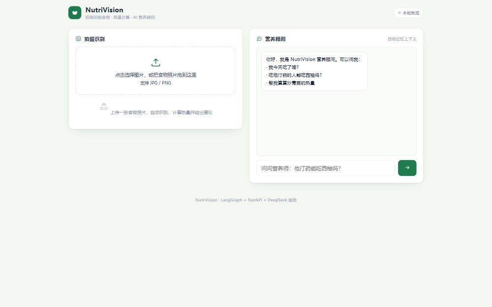
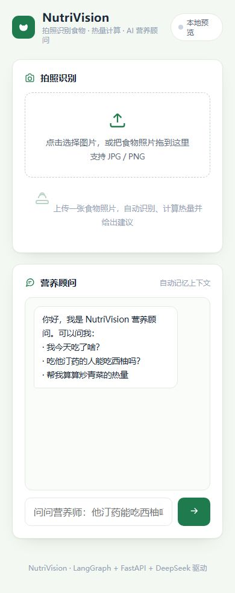

# NutriVision · AI 食物识别与营养分析 Agent

拍照识别食物，匹配营养表，估算热量并生成饮食建议；支持带记忆的饮食顾问对话和历史报告。



## 功能

- **食物识别**：调用 DeepSeek 多模态 API，用 Prompt 工程 + `JsonOutputParser` 输出食物名称、克重与置信度。
- **LangGraph 工作流**：`识别 → 营养匹配 → 热量计算 → 建议生成 → 报告存储`。
- **低置信处理**：服务端版本自动重试；重试仍失败则走 `give_up` 兜底，不生成虚假结果。
- **饮食顾问 Agent**：ReAct 循环 + 工具调用（今日摄入、营养知识库、热量计算、历史记录）。
- **会话记忆**：`MemorySaver` + `thread_id` 隔离，同一会话第二轮可直接复用上轮结果。
- **RAG**：BGE 嵌入 + 营养知识库分块检索，回答仅依据检索到的资料。
- **服务化**：FastAPI 四个接口 + 原生 HTML/CSS/JS 单页前端。

## 技术栈

Python 3.12+ · FastAPI · LangGraph · LangChain · OpenAI SDK（DeepSeek 兼容接口）· BGE / sentence-transformers · HTML / CSS / JavaScript

## 架构

```text
Browser
  │
  ├── POST /api/analyze ──► workflow.py（LangGraph）
  │                           ├─ DeepSeek 多模态识别（JSON）
  │                           ├─ 营养表匹配
  │                           ├─ 热量计算
  │                           ├─ DeepSeek 生成建议
  │                           └─ records/report_*.json
  │
  ├── POST /api/chat ─────► agent.py（ReAct + 工具 + MemorySaver）
  │                           └─ rag.py → BGE 嵌入 → nutrition_kb.txt
  │
  └── GET  /api/history ──► records/*.json
```

## 接口

| 方法 | 路径 | 说明 |
|---|---|---|
| GET | `/api/hello` | 健康检查 |
| POST | `/api/analyze` | 上传食物图片（form 字段 `file`），返回识别报告 |
| POST | `/api/chat` | 饮食顾问对话，JSON：`message` + `thread_id` |
| GET | `/api/history` | 历史识别报告列表 |

启动后可在 `http://127.0.0.1:8000/docs` 查看 FastAPI 自动生成的接口文档。

## 快速开始

```powershell
python -m venv .venv
.venv\Scripts\activate

pip install -r requirements.txt

copy .env.example .env
# 编辑 .env，填入 DEEPSEEK_API_KEY

uvicorn main:app --host 127.0.0.1 --port 8000
```

打开 `http://127.0.0.1:8000/`。

注意：

- 首次启动会下载 `BAAI/bge-small-zh-v1.5` 嵌入模型，需要一定时间和磁盘空间。
- 图片识别与建议生成需要可用的 DeepSeek API Key；没有 Key 时服务可以启动，但相关接口会失败。
- `workflow.py` 和 `agent.py` 中的模型名是 `deepseek-flash`，如账号不可用可改为自己可用的模型。

## 测试

先启动服务，再运行：

```powershell
python test_api.py
```

覆盖 `/api/hello`、`/api/chat`（两轮记忆）、`/api/history` 和空消息 400 兜底。

## 目录

```text
nutrivision/
├── main.py             # FastAPI 入口与 4 个接口
├── workflow.py         # 识别工作流
├── agent.py            # 饮食顾问 Agent
├── rag.py              # BGE 嵌入与检索
├── nutrition_kb.txt    # 营养知识库
├── static/index.html   # 前端页面
├── test_api.py         # 接口验收脚本
└── requirements.txt
```

## 已知边界

- 营养表只覆盖少量常见食物，未命中时按 0 处理并跳过建议生成。
- 今日摄入、历史记录等工具返回的是演示数据，不是真实用户数据。
- 项目是个人学习与作品展示用途，不构成医疗或营养建议。
- 服务未实现用户认证、生产级限流与监控；公网部署时需要额外加固。

## 界面

| 桌面端 | 移动端 |
|---|---|
|  |  |
