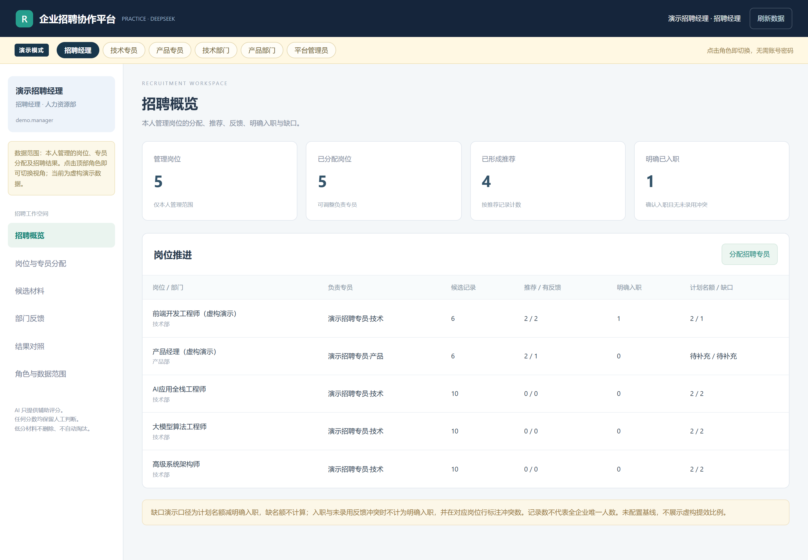
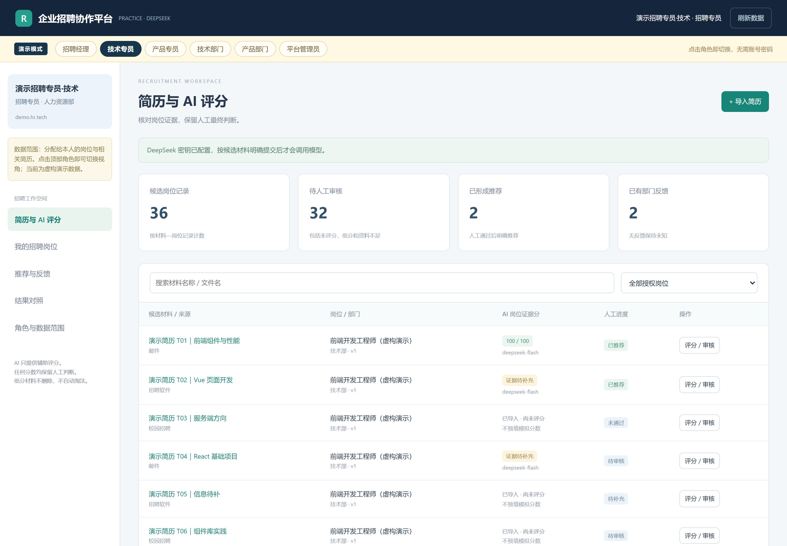
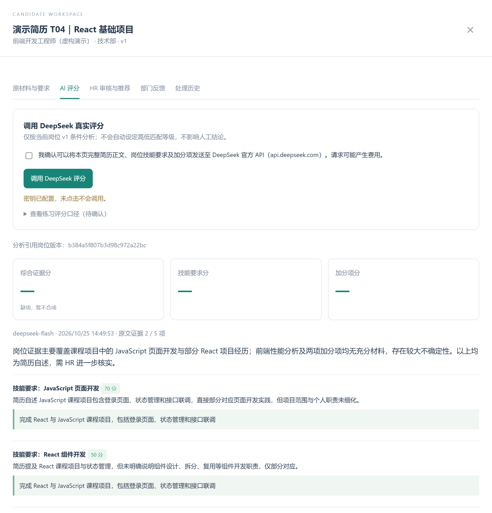

# 招聘协作平台 · AI 简历分拣

面向招聘场景的多角色协作平台：简历入库 → AI 逐条打分 → HR 复核 → 部门推荐 → 反馈验证。AI 只辅助判断，不自动淘汰候选人。

> 本项目是 FDE 训练营的**模拟企业招聘场景**，演示岗位、简历、账号与反馈均为虚构数据，不代表任何真实企业或候选人。



## 功能

- **多角色权限**：平台管理员、招聘经理、招聘专员、用人部门，各自有独立数据范围。
- **简历导入**：TXT / DOCX / PDF；PDF 需要 `pypdf`，扫描件不做 OCR。
- **AI 逐条评分**：调用 DeepSeek Chat Completions，按岗位条件逐项打分，并要求引用简历原文；引文无法在原文中校验时，该项转为“缺证据”，不记零分。
- **HR 人工复核**：AI 结果与 HR 审核相互独立；HR 可以基于事实人工通过，低分材料也不会被系统自动淘汰。
- **推荐与部门反馈**：HR 明确通过后才能推荐；用人部门独立填写阶段、专业意见和结果。
- **操作留痕**：岗位版本、评分历史、审核、推荐与反馈均保留记录，不覆盖旧版本。
- **本地优先**：服务默认只绑定 `127.0.0.1`，账号与招聘数据保存在本机 SQLite。

## 技术栈

Python 3.10+ · `http.server` / `ThreadingHTTPServer` · SQLite · DeepSeek Chat Completions · HTML / CSS / JavaScript · pytest

## 架构

```text
Browser（原生 HTML/CSS/JS）
  │
  ▼
127.0.0.1:8772  deepseek_server.py
  ├─ 账号 / 会话 / 权限校验
  ├─ 简历解析（TXT / DOCX / PDF）
  ├─ DeepSeek 评分 + 原文引用校验
  └─ recruitment_store.py
        └─ recruitment.sqlite3（本机，不提交）
```

## 角色

| 角色 | 主要能力 |
|---|---|
| 平台管理员 | 创建 / 停用账号，查看账号操作记录；不读取简历正文 |
| 招聘经理 | 建岗位、维护要求版本、分配专员、查看本人岗位进度 |
| 招聘专员 | 导入材料、发起 AI 评分、HR 复核、推荐给用人部门 |
| 用人部门 | 查看推荐给本部门的材料，填写专业反馈与招聘结果 |

## 快速开始

```powershell
python -m venv .venv
.venv\Scripts\activate

pip install -r requirements.txt -r requirements-dev.txt

# 1) 配置本机环境变量（不要把真实 Key 写进代码）
copy env.example.ps1 env.local.ps1
# 编辑 env.local.ps1，填入 DEEPSEEK_API_KEY
. .\env.local.ps1

# 2) 建立虚构演示数据（首次运行）
python 建立虚构演示数据.py

# 3) 启动
python deepseek_server.py
```

浏览器打开 `http://127.0.0.1:8772/`。

说明：

- `env.local.ps1` 只保存在本机，已在 `.gitignore` 中排除。
- 不配置 `DEEPSEEK_API_KEY` 也能浏览账号、岗位和招聘流程，但 AI 评分不可用。
- `RECRUITMENT_DEMO_MODE=1` 时开启免密码演示切换，仅适用于本机虚构数据；处理真实简历前应关闭。
- 首次建库会生成虚构账号、岗位和简历；账号信息保存在本机，不提交仓库。

## 测试

```powershell
python -m pytest -q
```

测试使用隔离的临时数据库和模型替身，不访问外网、不使用真实简历或真实 API Key，覆盖存储层、权限、评分失败、引文校验、推荐与反馈等路径。

## 目录

```text
recruitment-platform/
├── deepseek_server.py              # HTTP 服务、模型调用、简历解析
├── recruitment_store.py            # SQLite 存储、账号、权限、业务记录
├── 建立虚构演示数据.py              # 一次性建库脚本
├── 招聘简历分拣平台_交互原型.html    # 前端页面
├── test_deepseek_server.py         # 服务端测试
├── test_recruitment_store.py       # 存储层测试
├── screenshots/                    # 界面截图
├── requirements.txt                # 运行依赖（pypdf）
├── requirements-dev.txt            # 测试依赖（pytest）
└── env.example.ps1                 # 环境变量模板
```

## 评分口径与边界

- 当前评分规则是练习方案：技能条件 80% + 加分项 20%；无加分项时技能条件 100%。这不是客观能力分数，也不代表录用概率。
- 任一条件缺少有效原文证据时，不合成综合分，保留可用逐项结果。
- 项目是本地演示与作品展示版本，未实现企业 SSO、密码找回、云部署、OCR、生产级审计与安全加固。
- 演示数据均为虚构；不要用真实候选人资料运行演示模式。

## 界面

| AI 评分 | HR 复核 |
|---|---|
|  |  |
